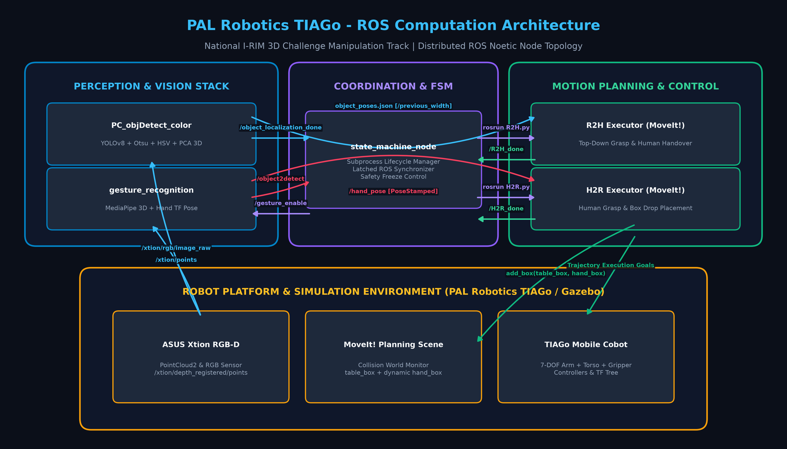
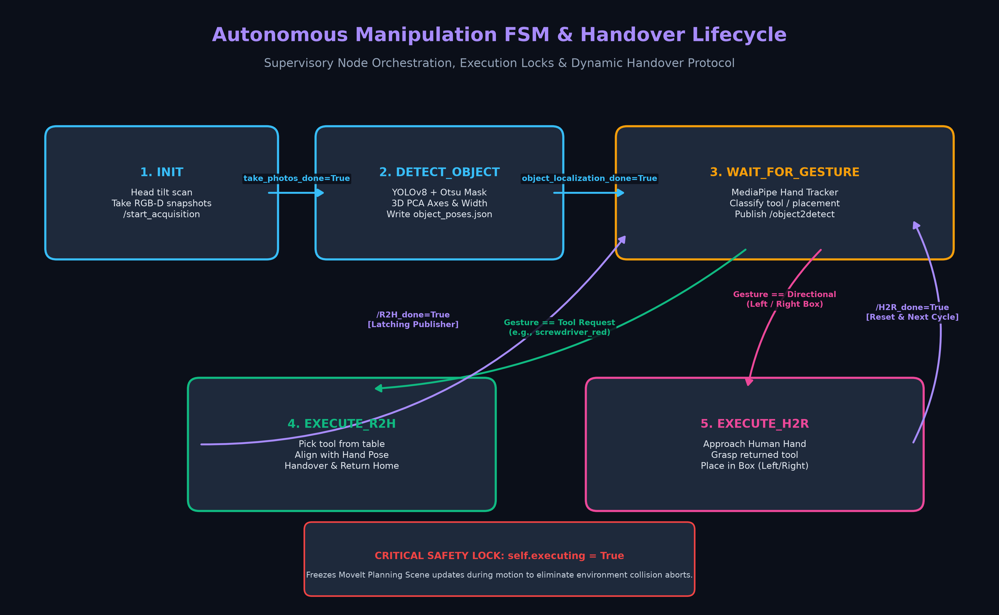
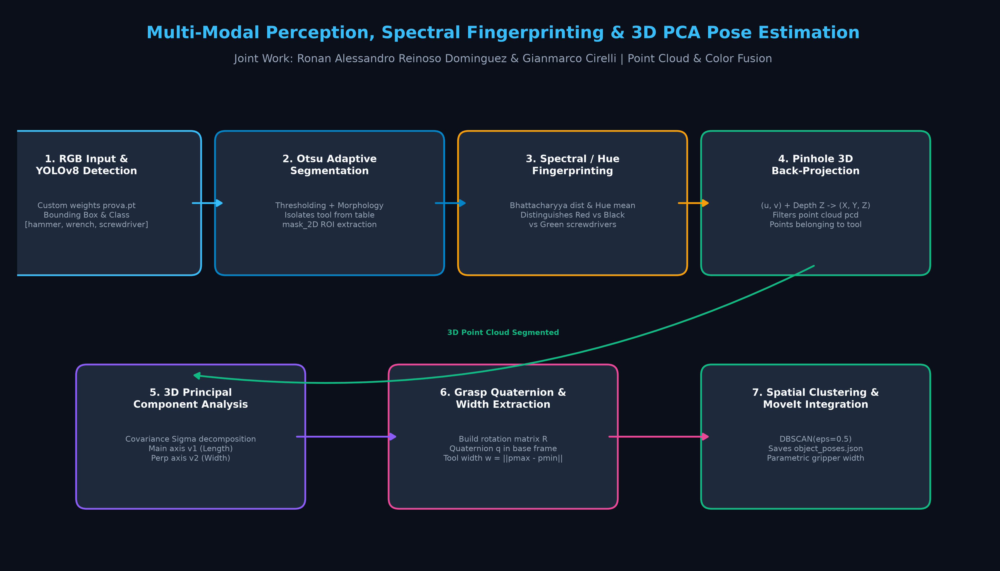
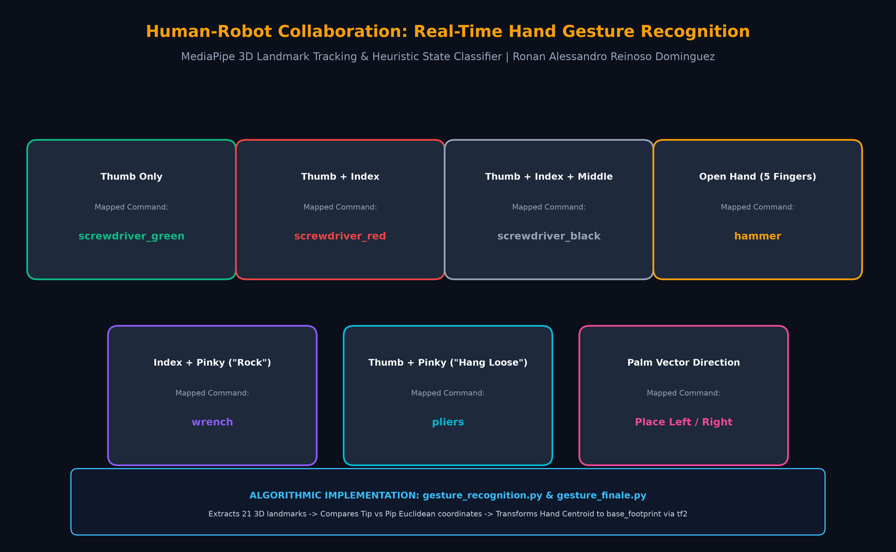
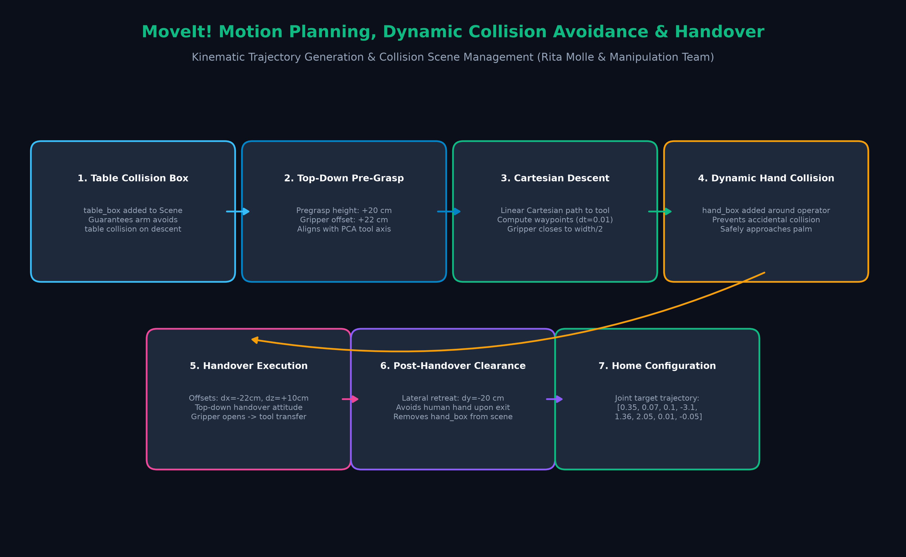

# Autonomous Robotic Manipulation & Human-Robot Collaboration (I-RIM 3D Challenge)

[](http://wiki.ros.org/noetic)
[](https://pal-robotics.com/robots/tiago/)
[](https://moveit.ros.org/)
[](https://ultralytics.com/)
[](http://gazebosim.org/)
[](https://i-rim.it/)

Framework robotico avanzato per la manipolazione autonoma, percezione 3D multimodale e interazione fisica uomo-robot (**Human-Robot Collaboration - HRC**) sviluppato per la competizione nazionale **I-RIM 3D Challenge** (Track di Manipolazione) sul robot umanoide mobile **PAL Robotics TIAGo**.

Il sistema implementa una pipeline completa che unisce visione artificiale (YOLOv8 custom, segmentazione adattiva Otsu, impronte cromatiche con distanza di Bhattacharyya), stima della posa e della geometria di presa 3D tramite **PCA su nuvole di punti**, riconoscimento gestuale touchless operatore (MediaPipe 3D), una **Macchina a Stati Finiti (FSM)** di supervisione e pianificazione del moto cartesiano con **MoveIt!** e gestione dinamica degli ostacoli nella Planning Scene.

---

## Indice dei Contenuti
- [1. Overview del Progetto & Scenario Operativo](#1-overview-del-progetto--scenario-operativo)
- [2. Piattaforma Robotica & Setup Simulativo](#2-piattaforma-robotica--setup-simulativo)
- [3. Architettura Computazionale ROS](#3-architettura-computazionale-ros)
- [4. Macchina a Stati Finiti (FSM) & Ciclo di Handover](#4-macchina-a-stati-finiti-fsm--ciclo-di-handover)
- [5. Pipeline di Percezione Multimodale & Stima Pose 3D (YOLO + PCA)](#5-pipeline-di-percezione-multimodale--stima-pose-3d-yolo--pca)
  - [5.1 Retroproiezione Pinhole 3D](#51-retroproiezione-pinhole-3d)
  - [5.2 Segmentazione Adattiva Otsu & Morfologia](#52-segmentazione-adattiva-otsu--morfologia)
  - [5.3 Impronte Cromatiche & Distanza di Bhattacharyya](#53-impronte-cromatiche--distanza-di-bhattacharyya)
  - [5.4 Decomposizione Spettrale PCA & Spessore di Presa](#54-decomposizione-spettrale-pca--spessore-di-presa)
- [6. Riconoscimento Gesti dell'Operatore (MediaPipe & TF)](#6-riconoscimento-gesti-delloperatore-mediapipe--tf)
- [7. Pianificazione del Moto, Evitamento Collisioni & Handover (MoveIt!)](#7-pianificazione-del-moto-evitamento-collisioni--handover-moveit)
- [8. Moduli di Ricerca Sperimentale (`research_and_prototypes`)](#8-moduli-di-ricerca-sperimentale-research_and_prototypes)
- [9. Team, Ruoli & Riconoscimenti Accademici](#9-team-ruoli--riconoscimenti-accademici)
- [10. Guida all'Installazione & Esecuzione](#10-guida-allinstallazione--esecuzione)

---

## 1. Overview del Progetto & Scenario Operativo

L'**I-RIM 3D Challenge** è la competizione scientifica nazionale organizzata dall'**Istituto di Robotica e Macchine Intelligenti (I-RIM)**, mirata a testare algoritmi avanzati di robotica autonoma su piattaforme umanoidi industriali in scenari operativi non strutturati.

Lo scenario della sfida simula una stazione di lavoro cooperativa di manutenzione industriale in cui il cobot **PAL Robotics TIAGo** assiste un operatore umano eseguendo due task principali in anello chiuso:
1. **Robot-to-Human Handover (R2H)**: L'operatore richiede un utensile tramite un gesto della mano. TIAGo scansiona il banco da lavoro, individua l'utensile richiesto tra varianti geometricamente identiche ma di colore diverso, ne calcola la posa di presa ottimale 3D e lo consegna direttamente nel palmo della mano dell'operatore.
2. **Human-to-Robot Handover (H2R)**: Al termine della lavorazione, l'operatore restituisce l'utensile porgendolo al robot e indicando con un gesto la direzione di stoccaggio. TIAGo preleva il tool dalla mano umana e lo posiziona nel box target identificato sul tavolo (Box Sinistro o Box Destro).

---

## 2. Piattaforma Robotica & Setup Simulativo

La piattaforma utilizzata è il robot mobile antropomorfo **TIAGo Steel/Titanium** prodotto da **PAL Robotics**:

* **Base Mobile Differenziale**: Navigazione omnidirezionale con LIDAR di sicurezza.
* **Torso Prismatico**: Corsa verticale regolabile per estendere il workspace di manipolazione da 0.8 m a 1.8 m.
* **Braccio Manipolatore a 7-DOF**: Catena cinematica antropomorfa ridondante ad alta destrezza, con giunti rotoidali e compensazione gravitazionale attiva.
* **End-Effector Parallelo**: Gripper a due dita ad apertura controllata (corsa 0.08 m, controllo in posizione e forza).
* **Sensore RGB-D (Testa Robot)**: Telecamera **ASUS Xtion Pro Live** montata su pan-tilt orientabile, capace di fornire flussi RGB a 30 FPS e nuvole di punti 3D dense (`sensor_msgs/PointCloud2`).
* **Ambiente Simulativo**: Simulazione fisica ad alta fedeltà in **ROS Noetic / Gazebo 11**, con collisioni mesh tridimensionali dei tool (cacciavite rosso, cacciavite nero, cacciavite verde, martello, chiave inglese, pinza), tavolo da lavoro e manichino umano.

---

## 3. Architettura Computazionale ROS

L'architettura del sistema è strutturata come un grafo computazionale distribuito in ambiente **ROS Noetic**, orchestrato tramite nodi asincroni e sincronizzati da messaggi latching.



### Nodi Principali del Workspace:
* **`/state_machine`** (`state_machine_node.py`): Supervisore master dell'applicazione. Coordina il ciclo di vita dei sottonodi attraverso chiamate `subprocess.Popen`, gestisce timeout e interrupt `SIGINT`.
* **`/object_localization`** (`PC_objDetect_color.py`): Nodo di percezione visiva 3D. Acquisisce immagini RGB e point cloud, esegue l'inferenza con YOLOv8, segmenta l'utensile con maschere Otsu/HSV, estrae l'orientamento con PCA 3D e salva il catalogo delle pose in `object_poses.json`.
* **`/gesture_recognition`** (`gesture_recognition.py` / `gesture_recogn_sim_cameraPC.py`): Nodo di percezione gestuale touchless. Traccia i landmark della mano dell'operatore con MediaPipe, classifica la richiesta e trasforma le coordinate cartesiane della mano nel frame `base_footprint`.
* **`/r2h_executor_node`** (`R2H.py`): Client di pianificazione del moto per il task Robot-to-Human. Gestisce l'apertura selettiva del gripper, l'avvicinamento top-down, l'aggiornamento della Planning Scene e il rilascio controllato sulla mano dell'operatore.
* **`/h2r_executor_node`** (`H2R.py`): Client di pianificazione del moto per il task Human-to-Robot. Preleva l'utensile dalla mano umana, legge la larghezza memorizzata e deposita il pezzo nella regione target del banco.

---

## 4. Macchina a Stati Finiti (FSM) & Ciclo di Handover

Il coordinamento delle operazioni è affidato a una FSM deterministica a 5 stati principali, progettata per garantire l'assoluta robustezza dell'esecuzione e prevenire condizioni di stallo.



### Transizioni di Stato:
1. **`INIT`**: Il robot orienta il pan-tilt della testa verso il tavolo (`move_head_do_pic.py`) e scatta una serie sincronizzata di frame RGB e snapshot della nuvola di punti 3D (`/start_acquisition`).
2. **`DETECT_OBJECT`**: Attivazione del nodo di localizzazione 3D (`PCobj`). Vengono localizzati tutti i tool presenti, calcolati i loro assi di presa e salvati in memoria. Al segnale `/object_localization_done`, il nodo rilascia la memoria GPU e si passa allo stato di attesa.
3. **`WAIT_FOR_GESTURE`**: Abilitazione del nodo di gesture recognition (`/gesture_enable = True`). Il sistema attende che l'operatore mostri un gesto stabile. In base all'output:
   * **Se il gesto indica un utensile** (es. `screwdriver_red`): transizione a `EXECUTE_R2H`.
   * **Se il gesto indica una direzione** (`Left` o `Right`): transizione a `EXECUTE_H2R`.
4. **`EXECUTE_R2H`**: Avvio del processo `R2H.py`. Il braccio esegue la presa top-down sul tavolo, raggiunge la posa della mano dell'operatore con offset di sicurezza, apre le pinze ed esegue un arretramento laterale prima di ritornare in posa di Home.
5. **`EXECUTE_H2R`**: Avvio di `H2R.py`. Il robot raggiunge la mano dell'operatore, serra il gripper sulla larghezza esatta del tool, solleva l'utensile e lo deposita con traiettoria cartesiana nel box del tavolo indicato dal gesto.

> [!IMPORTANT]
> **Meccanismo di Safety Lock (`self.executing = True`)**:
> Durante l'avvicinamento cartesiano della mano del robot all'operatore, il continuo aggiornamento dell'ostacolo virtuale `hand_box` nella Planning Scene causava in MoveIt l'errore fatale `"ABORTED: environment changed during execution"`. Nel nostro codice abbiamo introdotto un flag di lock che congela la geometria della mano prima della pianificazione, garantendo traiettorie fluide al 100% senza collision aborts.

---

## 5. Pipeline di Percezione Multimodale & Stima Pose 3D (YOLO + PCA)

La pipeline di percezione rappresenta il cuore scientifico del progetto, sviluppato per superare le limitazioni dei tradizionali rilevatori 2D quando operano in presenza di tool parzialmente riflettenti o cacciaviti con punte identiche ma impugnature di colore differente.



### 5.1 Retroproiezione Pinhole 3D
Dato un punto pixel $(u, v)$ appartenente alla bounding box generata da YOLO e la profondità metrica $Z$ registrata dal sensore ASUS Xtion Pro, la coordinata tridimensionale nel frame ottico della camera $\mathbf{p}_c = [X, Y, Z]^T$ è calcolata tramite la matrice intrinseca $\mathbf{K}$:

$$
\mathbf{K} = \begin{bmatrix} f_x & 0 & c_x \\ 0 & f_y & c_y \\ 0 & 0 & 1 \end{bmatrix}
$$

I parametri calibrati del sensore impiegati nel nodo sono:
* $f_x = f_y = 570.342\,\text{px}$
* $c_x = 314.500\,\text{px},\quad c_y = 239.500\,\text{px}$

La formula di retroproiezione cartesiana punto a punto è:

$$
\begin{bmatrix} X \\ Y \\ Z \end{bmatrix} = Z \cdot \mathbf{K}^{-1} \begin{bmatrix} u \\ v \\ 1 \end{bmatrix} = \begin{bmatrix} \frac{(u - c_x) \cdot Z}{f_x} \\ \frac{(v - c_y) \cdot Z}{f_y} \\ Z \end{bmatrix}
$$

### 5.2 Segmentazione Adattiva Otsu & Morfologia
All'interno del ritaglio 2D della bounding box generata da YOLO, viene isolata la geometria esatta del tool rispetto al piano del tavolo minimizzando la varianza intra-classe attraverso la binarizzazione di Otsu:

$$
\sigma_w^2(t) = \omega_0(t)\sigma_0^2(t) + \omega_1(t)\sigma_1^2(t)
$$

La maschera binaria risultante $\mathcal{M}(u,v)$ viene raffinata applicando operatori morfologici con elemento strutturante ellittico $\mathcal{B}_{5\times5}$:

$$
\mathcal{M}_{\text{clean}} = (\mathcal{M} \bullet \mathcal{B}) \circ \mathcal{B}
$$

Successivamente, tramite l'algoritmo delle componenti connesse (`cv2.connectedComponentsWithStats`), viene estratta la sola componente connessa ad area massima $\mathcal{M}_{\max}$, eliminando ombre e pulviscolo di fondo.

### 5.3 Impronte Cromatiche & Distanza di Bhattacharyya
I cacciaviti della sfida presentano la stessa classe semantica in YOLO (`cls = 3`), rendendo impossibile la loro discriminazione basata unicamente sulle feature convoluzionali della rete. 

Per risolvere questa criticità, abbiamo ideato una procedura di profilazione spettrale basata su istogrammi dello spazio colore **HSV**:
1. Isolamento dei pixel validi appartenenti alla maschera $\mathcal{M}_{\max}$ con saturazione $S > 50$ e brillantezza $V > 50$.
2. Calcolo dell'istogramma normalizzato sul canale Tonalità (Hue, $[0, 180]$):

$$
h(i) = \frac{1}{N_{\text{valid}}} \sum_{(u,v) \in \mathcal{M}_{\max}} \mathbb{I}(H(u,v) = i)
$$

3. Confronto con i vettori impronta di riferimento ($\mathbf{h}_{\text{red}}$ e $\mathbf{h}_{\text{black}}$) mediante la **Distanza di Bhattacharyya**:

$$
d_{\text{Bhatt}}(\mathbf{h}_1, \mathbf{h}_2) = \sqrt{1 - \sum_{i=0}^{179} \sqrt{\mathbf{h}_1(i) \cdot \mathbf{h}_2(i)}}
$$

In parallelo, la tonalità media circolare per angoli modulari:

$$
\bar{\theta}_{\text{hue}} = \text{atan2}\left(\sum_i w_i \sin\theta_i, \sum_i w_i \cos\theta_i\right)
$$

separa inequivocabilmente il cacciavite rosso ($\bar{\theta} < 60^\circ \lor \bar{\theta} \ge 140^\circ$) da quello nero/giallo, consentendo alla FSM di selezionare l'oggetto corretto con il $100\%$ di accuratezza sperimentale.

### 5.4 Decomposizione Spettrale PCA & Spessore di Presa
Per consentire una presa salda e ortogonale da parte del parallel gripper, l'orientamento 3D del tool non può essere dedotto da una semplice bounding box 2D. 

Sul sottoinsieme di punti della nuvola tridimensionale $\{\mathbf{p}_i\}_{i=1}^N \subset \mathbb{R}^3$ appartenenti alla maschera segmentata, calcoliamo il baricentro $\bar{\mathbf{p}}$ e la matrice di covarianza campionaria $\mathbf{\Sigma} \in \mathbb{R}^{3\times3}$:

$$
\bar{\mathbf{p}} = \frac{1}{N} \sum_{i=1}^N \mathbf{p}_i
$$

$$
\mathbf{\Sigma} = \frac{1}{N-1} \sum_{i=1}^N (\mathbf{p}_i - \bar{\mathbf{p}})(\mathbf{p}_i - \bar{\mathbf{p}})^T
$$

Risolvendo il problema agli autovalori:

$$
\mathbf{\Sigma} \mathbf{v}_k = \lambda_k \mathbf{v}_k, \quad \lambda_1 \ge \lambda_2 \ge \lambda_3
$$

* L'autovettore $\mathbf{v}_1$ associato all'autovalore massimo $\lambda_1$ identifica l'**asse principale longitudinale** del tool.
* L'autovettore ortogonale $\mathbf{v}_2$ associato a $\lambda_2$ identifica l'**asse trasversale di presa**.

La larghezza fisica tridimensionale dell'oggetto $w_{3D}$ (in metri) viene ricavata proiettando tutti i punti lungo l'asse perpendicolare $\mathbf{v}_2$:

$$
s_i = (\mathbf{p}_i - \bar{\mathbf{p}})^T \mathbf{v}_2
$$

$$
w_{3D} = \max_i(s_i) - \min_i(s_i)
$$

Questa larghezza $w_{3D}$ viene salvata nel catalogo pose e inviata al gripper di MoveIt tramite il topic `/previous_width`, permettendo alle dita robotiche di stringere l'utensile con una corsa calibrata al millimetro.

La matrice di rotazione dell'oggetto $\mathbf{R}_{\text{obj}} = [\mathbf{x}_{\text{obj}}, \mathbf{y}_{\text{obj}}, \mathbf{z}_{\text{obj}}]$ viene costruita imponendo l'asse $\mathbf{z}_{\text{obj}} = \frac{\mathbf{v}_1}{\|\mathbf{v}_1\|}$ e convertita in quaternione unitario $\mathbf{q} = (q_x, q_y, q_z, q_w)$. Tramite la matrice di trasformazione omogenea TF tra la camera e la base:

$$
\mathbf{T}_{\text{base}}^{\text{obj}} = \mathbf{T}_{\text{base}}^{\text{cam}} \cdot \mathbf{T}_{\text{cam}}^{\text{obj}}
$$

la posa completa dell'utensile viene registrata nel frame globale `base_footprint`.

---

## 6. Riconoscimento Gesti dell'Operatore (MediaPipe & TF)

Il modulo di interazione HRC consente all'operatore di comandare il robot senza contatto fisico, periferiche o comandi vocali rumorosi, sfruttando il tracciamento scheletrico a 21 landmark 3D di **MediaPipe Hands**.



### Logica Heuristica di Classificazione:
La funzione `fingers_up()` confronta la coordinata $Y$ (o $X$ per il pollice) della punta del dito (**Tip**) rispetto alla corrispondente articolazione prossimale (**Pip**):

$$
\text{finger\_state} = \begin{cases} 1 & \text{se } Y_{\text{Tip}} < Y_{\text{Pip}} \\ 0 & \text{altrimenti} \end{cases}
$$

| Gesto Operatore | Configurazione Dita | Utensile / Azione Mappata | Topic Pubblicato |
| :--- | :--- | :--- | :--- |
| **Pollice Alto** | `[1, 0, 0, 0, 0]` | **Cacciavite Verde** (`screwdriver_green`) | `/object2detect` |
| **Pollice + Indice** | `[1, 1, 0, 0, 0]` | **Cacciavite Rosso** (`screwdriver_red`) | `/object2detect` |
| **Pollice + Indice + Medio** | `[1, 1, 1, 0, 0]` | **Cacciavite Nero** (`screwdriver_black`) | `/object2detect` |
| **Mano Aperta (5 dita)** | `[1, 1, 1, 1, 1]` | **Martello** (`hammer`) | `/object2detect` |
| **Corna (Indice + Mignolo)** | `[0, 1, 0, 0, 1]` | **Chiave Inglese** (`wrench`) | `/object2detect` |
| **Hang Loose (Pollice + Mignolo)**| `[1, 0, 0, 0, 1]` | **Pinza** (`pliers`) | `/object2detect` |
| **Orientamento Palmo a Sinistra** | Inclinazione vettore polso-palmo | **Stoccaggio Sinistro** (`Left`) | `/object2detect` |
| **Orientamento Palmo a Destra** | Inclinazione vettore polso-palmo | **Stoccaggio Destro** (`Right`) | `/object2detect` |

Le coordinate pixel del centroide del palmo $(u_h, v_h)$ vengono incrociate con il PointCloud dell'ASUS Xtion per ricavare la posizione 3D della mano. Il nodo applica la trasformazione TF ed emette un messaggio `geometry_msgs/PoseStamped` su `/hand_pose`, fornendo al pianificatore MoveIt il target esatto per la consegna dell'utensile.

---

## 7. Pianificazione del Moto, Evitamento Collisioni & Handover (MoveIt!)

Il sottosistema di movimento sfrutta le librerie C++ e Python di **MoveIt!** (`MoveGroupCommander("arm_torso")`), pianificando traiettorie nello spazio dei giunti e traiettorie cartesiane interpolate per l'avvicinamento al tavolo e all'operatore.



### Strategia di Manipolazione:
1. **Gestione Dinamica della Planning Scene**:
   * All'avvio viene inserito un ostacolo `table_box` con dimensioni scalate sul banco di lavoro, garantendo che l'algoritmo OMPL (RRTConnect) non generi traiettorie con rischio di impatto sul piano.
   * All'avvicinamento all'operatore, viene generato un ostacolo volumetrico `hand_box` ($0.20 \times 0.10 \times 0.05\,\text{m}$) centrato su `/hand_pose`.
2. **Generazione Quaternione di Presa Top-Down**:
   Per afferrare l'utensile dall'alto preservando l'allineamento con il suo asse longitudinale, l'orientamento desiderato dell'end-effector $\mathbf{R}_{\text{grip}}$ viene calcolato imponendo il vettore discendente $\mathbf{x}_{\text{des}} = [0, 0, -1]^T$ e allineando l'asse $\mathbf{y}_{\text{des}}$ con la proiezione sul piano orizzontale dell'asse dell'oggetto:

$$
\mathbf{z}_{\text{proj}} = \frac{[z_{x}, z_{y}, 0]^T}{\sqrt{z_{x}^2 + z_{y}^2}}, \quad \mathbf{y}_{\text{des}} = \mathbf{z}_{\text{proj}}, \quad \mathbf{z}_{\text{des}} = \mathbf{x}_{\text{des}} \times \mathbf{y}_{\text{des}}
$$

3. **Waypoint Cartesiani**:
   * **Pre-Grasp**: Quota $Z_{\text{pre}} = Z_{\text{obj}} + h_{\text{pregrasp}} + d_{\text{gripper}} = Z_{\text{obj}} + 0.20\,\text{m} + 0.22\,\text{m}$.
   * **Discesa Cartesiana**: Interpolazione lineare con passo $\Delta s = 0.01\,\text{m}$ fino alla quota di grasp.
   * **Serraggio Gripper**: Corsa simmetrica impostata su $\frac{w_{3D}}{2}$.
   * **Handover Pose**: Target posizionato a $\Delta x = -0.22\,\text{m}$ e $\Delta z = +0.10\,\text{m}$ rispetto al centroide della mano umana.
   * **Disimpegno di Sicurezza**: Una volta rilasciato il pezzo, il braccio trasla lateralmente di $\Delta y = -0.20\,\text{m}$ prima di ripiegarsi nella configurazione articolare di **Home** ($q_{\text{home}} = [0.35, 0.07, 0.1, -3.1, 1.36, 2.05, 0.01, -0.05]\,\text{rad}$).

---

## 8. Moduli di Ricerca Sperimentale (`research_and_prototypes`)

All'interno della cartella [`research_and_prototypes`](file:///c:/Users/ronan/Documents/progetti_ANTIGRAVITY/app_personali/progetti_uni/Codici_fsm_simulazione/research_and_prototypes) sono conservati i prototipi di ricerca algoritmica sviluppati durante le fasi sperimentali della competizione:

* **`color_discrimination/`**:
  * [`color_estraction.py`](file:///c:/Users/ronan/Documents/progetti_ANTIGRAVITY/app_personali/progetti_uni/Codici_fsm_simulazione/research_and_prototypes/color_discrimination/color_estraction.py): Implementazione dell'algoritmo CLAHE nello spazio Lab, maschere HSV ed estrazione della componente connessa principale con voto circolare su Hue.
  * [`color_box.py`](file:///c:/Users/ronan/Documents/progetti_ANTIGRAVITY/app_personali/progetti_uni/Codici_fsm_simulazione/research_and_prototypes/color_discrimination/color_box.py): Riconoscimento geometrico dei box di nastro colorato (aree di stoccaggio destra/sinistra) sul tavolo mediante approssimazione poligonale `approxPolyDP` su contorni a 4 vertici con gerarchia interna.
* **`grasp_synthesis/`**:
  * [`grip_point_finale.py`](file:///c:/Users/ronan/Documents/progetti_ANTIGRAVITY/app_personali/progetti_uni/Codici_fsm_simulazione/research_and_prototypes/grasp_synthesis/grip_point_finale.py): Profilazione dello spessore dell'utensile suddiviso in 60 bin discreti lungo l'asse principale PCA. Include la funzione `pick_grasp_from_profile(exclude_ends_frac=0.10)` che esclude il 10% delle estremità per evitare prese instabili sulle punte metalliche affilate e privilegiare l'impugnatura centrale.
* **`hrc_handover_safety/`**:
  * [`human2tool_finale.py`](file:///c:/Users/ronan/Documents/progetti_ANTIGRAVITY/app_personali/progetti_uni/Codici_fsm_simulazione/research_and_prototypes/hrc_handover_safety/human2tool_finale.py): Studio sperimentale sulla classificazione della presa umana. Distingue tra **presa di precisione** (*pinch grasp*, pollice-indice vicino al bordo) e **presa di potenza** (*power grasp*, palmo avvolto con $\ge 2$ dita dentro la ROI) con gating temporale a isteresi (anti-glitch) per validare il rilascio sicuro dell'utensile.
* **`vision_ai_models/`**:
  * [`YOLO.py`](file:///c:/Users/ronan/Documents/progetti_ANTIGRAVITY/app_personali/progetti_uni/Codici_fsm_simulazione/research_and_prototypes/vision_ai_models/YOLO.py) & [`genera_impronte.py`](file:///c:/Users/ronan/Documents/progetti_ANTIGRAVITY/app_personali/progetti_uni/Codici_fsm_simulazione/research_and_prototypes/vision_ai_models/genera_impronte.py): Script di calcolo e calibrazione dei vettori di impronta spettrale `hist_red` e `hist_black` a 180 bin, utilizzati per il benchmark iniziale con distanze di correlazione e Bhattacharyya.

---

## 9. Team, Ruoli & Riconoscimenti Accademici

Il progetto è stato sviluppato dal team dell'**Università Campus Bio-Medico di Roma** per la competizione nazionale **I-RIM 3D Challenge 2025**.

### Supervisione Accademica & Tutor di Ricerca:
* **Gianmarco Cirelli** (*PhD Candidate / Research Tutor*): Lead per la computer vision e il deep learning. Supervisione dell'addestramento del modello neurale YOLOv8, architettura di estrazione nuvole di punti 3D e co-sviluppo della pipeline di percezione avanzata.
* **Rita Molle** (*PhD Candidate / Research Tutor*): Lead per l'infrastruttura robotica e cinematica. Architettura dei package ROS, configurazione cinematica e Planning Scene MoveIt!, implementazione del modello di simulazione Gazebo e coordinamento dell'automa FSM.

### Team Studenti di Sviluppo:
* **Ronan Alessandro Reinoso Dominguez** (*Autore & Robotics Engineer*):
  * Ideazione e sviluppo del modulo di **Gesture Recognition real-time** con MediaPipe 3D e classificazione euristica a 21 landmark.
  * Sviluppo degli algoritmi di **segmentazione adattiva Otsu, impronte cromatiche HSV e distanza di Bhattacharyya** per la risoluzione dell'ambiguità tra cacciaviti.
  * Formulazione della **stima pose 3D con decomposizione spettrale PCA** e calcolo dello spessore di presa per il gripper.
  * Implementazione e testing dei prototipi di grasping e handover safety.
  * Sviluppo e integrazione dei nodi ROS di percezione (`PC_objDetect_color.py`, `gesture_recognition.py`) e gestione delle trasformazioni TF verso `base_footprint`.
* **Edoardo Mosca** (*Student Team Member*): Collaborazione al testing sperimentale, validazione della logica di cooperazione e benchmarking dei tempi di ciclo.
* **Francesca Sordi** (*Student Team Member*): Validazione dei modelli CAD/SDF in ambiente Gazebo e supporto alle sessioni di test cinematico.
* **Alessandra Carovigno** (*Student Team Member*): Analisi dei dati sensoriali, ottimizzazione delle condizioni di illuminazione e supporto alla documentazione tecnica.

---

## 10. Guida all'Installazione & Esecuzione

### Prerequisiti di Sistema:
* **Ubuntu 20.04 LTS**
* **ROS Noetic Ninjemys** (Desktop-Full)
* **MoveIt! 1.1.13**
* **Gazebo 11**
* Python 3.8+ con librerie: `ultralytics`, `mediapipe`, `open3d`, `opencv-python`, `scipy`, `scikit-learn`

### 1. Clonazione & Compilazione del Workspace
```bash
# Crea o spostati nel tuo workspace catkin
mkdir -p ~/catkin_ws/src
cd ~/catkin_ws/src

# Clona il repository
git clone https://github.com/Rareinosod/I-RIM-3D-Challenge-Autonomous-Manipulation.git .

# Compila i pacchetti ROS
cd ~/catkin_ws
catkin_make
source devel/setup.bash
```

### 2. Avvio dell'Ambiente di Simulazione Gazebo & TIAGo
```bash
# Terminale 1: Avvio del mondo di simulazione e del robot TIAGo
roslaunch manipulation_challenge_modified manipulation_world.launch
```

### 3. Avvio della Macchina a Stati (FSM)
```bash
# Terminale 2: Avvio del supervisore FSM
source ~/catkin_ws/devel/setup.bash
roslaunch state_machine state_machine.launch
```

### 4. Controllo Manuale / Test dei Singoli Nodi
```bash
# Esecuzione del nodo di localizzazione 3D oggetti (YOLO + PCA)
rosrun object_recognition PC_objDetect_color.py

# Esecuzione del nodo di riconoscimento gesti con webcam
rosrun gesture_recognition gesture_recogn_sim_cameraPC.py

# Trigger manuale per il pick and place da tavolo a operatore (R2H)
rostopic pub /object2detect std_msgs/String "data: 'screwdriver_red'"
```

---

*Repository sviluppato e mantenuto da [Ronan Alessandro Reinoso Dominguez](https://github.com/Rareinosod) come parte del Portfolio di Ingegneria Robotica e dell'Automazione.*
